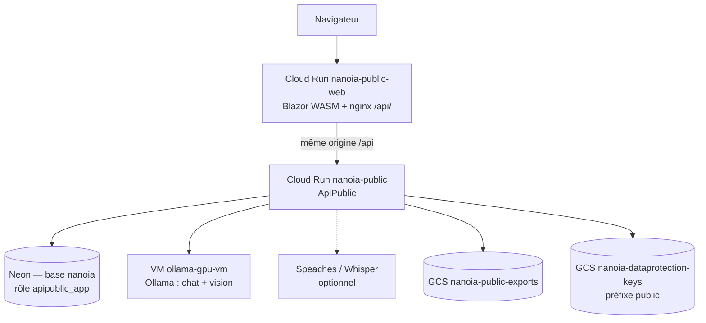

# Architecture Ramsess-AI

## Statut : ✅ Confirmé pour le code et les pipelines ; 🟡 pour le réseau GPU Cloud Run

Le navigateur ne parle qu'au front Cloud Run. L'API Public appelle Neon, Ollama et (si configuré)
Speaches. Aucun poids de modèle n'est dans l'image Cloud Run.

## Quatre machines / services

| Pièce | Rôle | Ne fait pas |
|---|---|---|
| `nanoia-public-web` | Sert le WASM. Proxy `/api/*` vers ApiPublic | N'appelle pas Ollama |
| `nanoia-public` | Auth, quotas, chat, billing, operator | N'indexe pas de documents RAG |
| `ollama-gpu-vm` | Inférence open source | N'héberge pas Postgres Public |
| Neon `nanoia` | Comptes, forfaits, opérateurs, exports métadonnées | Ce n'est **pas** la base RAG (`neondb`) |

La VM RAG Entreprise (`ramses-rag-vm` / `nanoia-rag-vm`) **n'entre pas** dans ce schéma. Elle reste
le Compose B2B.

## Flux d'un message

1. Le WASM envoie `POST /api/chat/stream` (CSRF + cookie session consommateur).
2. ApiPublic refuse un historique qui contient un rôle `system` (le prompt système est **serveur**).
3. Gates : abonnement actif (402) puis quota du jour (429) puis Fair Use (taille, jetons, `num_predict`).
4. Détection de langue → consigne fermée injectée. Salutation exacte (`bonjour`, `hello`, …) :
   réponse figée, **sans** appel GPU.
5. Sinon Inference.Core → Ollama. Image jointe → modèle vision du catalogue opérateur.
6. SSE vers le navigateur. Le bloc `<think>` DeepSeek n'est pas la réponse visible.

Le navigateur n'atteint jamais `11434`. Contourner ApiPublic pour parler à Ollama annulerait quota
et facturation.

## Données

| Secret / ressource | Usage |
|---|---|
| `NANOIA_PUBLIC_DATABASE_URL` | ApiPublic, **uniquement** `Username=apipublic_app` |
| `NANOIA_PUBLIC_DATABASE_ADMIN_URL` | `migrate-neon-public.yaml`, owner **non poolé**, DDL |
| `OLLAMA_VM_IP` | IP publique réservée de la VM GPU, pour Cloud Run |
| IP VPC `10.128.x.x` | VM RAG → Ollama en interne. **Pas** le secret Public |
| `SPEECH_ENDPOINT` | Speaches, indépendant d'Ollama. Vide = dictée absente |
| `…-nanoia-public-exports` | PDF / Word / PPTX du chat Public |
| `…-nanoia-dataprotection-keys` | Cookies, préfixe objet `public` |

`deploy-public.yaml` refuse une chaîne Neon propriétaire. C'est voulu.

## Stack applicative

| Couche | Techno |
|---|---|
| UI | Blazor WebAssembly (`BlazorWasmRag.Public`), UI partagée opt-in (`Shared.UI`) |
| API | ASP.NET Core `ApiPublic`, SQL brut Npgsql, **pas** EF Core |
| Orchestration LLM | `Inference.Core` + Semantic Kernel + connecteur Ollama |
| Identité visiteur | Cookie `ApiPublic.Session` (e-mail, Google, Microsoft, téléphone) |
| Identité admin | Même origine, **autre** cookie opérateur — la dernière connexion remplace l'autre |
| Paiement | `ICheckoutPaymentGateway` : Stub ou CinetPay |

## Décisions d'architecture déjà prises

- Deux produits, deux APIs, deux bases. Jamais `ApiRag` référencé depuis `ApiPublic`.
- Pas de téléchargement de modèle au runtime (`Speech__AllowRemoteDownload=false`).
- Pas de LibreOffice dans l'image Cloud Run (prompt 25 : aperçu fidèle facultatif, service séparé).
- GPU partagé au début ; file et Fair Use protègent Ollama. Une seconde VM Public viendra avec le trafic.
