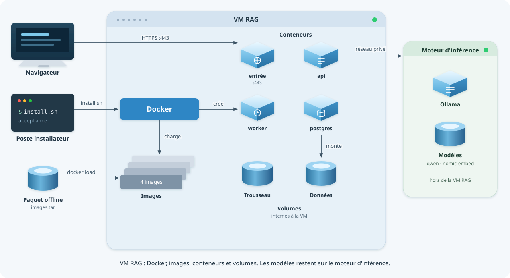

# Architecture d'installation


Deux machines. La VM RAG sert l'application. Le moteur d'inférence garde les modèles.



Même lecture que le schéma Docker classique. Le poste lance `install.sh`, Docker charge les images puis crée les conteneurs. Le navigateur n'atteint que l'entrée, en HTTPS. Postgres monte le volume de données, l'api le trousseau. Le trait pointillé quitte la VM : c'est `INFERENCE_ENDPOINT` vers Ollama, où sont déjà `qwen2.5:14b` et `nomic-embed-text`.

## Une ou deux machines

Pour un client B2B, **deux machines**.

| Machine | Ce qu'elle porte |
|---|---|
| VM RAMSES RAG | L'application, les comptes, les documents et les vecteurs |
| VM d'inférence | Les modèles `qwen2.5:14b` et `nomic-embed-text` |

Le paquet client (`pack-offline.sh`, profil `external`) ne contient pas les poids. `./models.sh` ne se lance pas sur la VM RAG.

Une seule machine reste possible avec `INFERENCE_PROFILE=ollama` : l'application et les poids partagent alors le même hôte, qui doit avoir le GPU et le disque des deux rôles. Ce profil convient à un essai ou à un petit site. Ce n'est pas le dimensionnement B2B.

## Où placer les deux machines

La pile est la même dans les trois cas. Seule l'adresse `INFERENCE_ENDPOINT` change. Le navigateur n'atteint que la VM RAG.

| Scénario | VM RAMSES RAG | VM d'inférence |
|---|---|---|
| B2B chez le client | Chez le client. Sur un serveur nu : `proxmox.md` | Chez le client, avec GPU |
| Hybride | Chez le client | Dans le SaaS NaNo-IA |
| SaaS | Dans le SaaS NaNo-IA | Dans le SaaS NaNo-IA |

En hybride, les documents et les comptes restent sur la VM du client. Les questions et les extraits envoyés au modèle partent vers le SaaS : le dire au client avant de retenir ce scénario.

Le port `11434` du moteur n'est ouvert que depuis la VM RAG (réseau privé du site, ou IP de sortie de cette VM s'il est dans le SaaS). Il n'est pas publié sur Internet.

## Stack technique embarquée

Docker Compose, sur la VM RAG :

| Rôle | Composant |
|---|---|
| Interface | Blazor WebAssembly, servi par Caddy. Seul service publié, ports 80 et 443. |
| API | ApiRag (.NET). Comptes, chat, historique de session. |
| Worker | Même image que l'API. Indexation et tâches de fond. |
| Données et vecteurs | PostgreSQL 16 avec pgvector. Comptes, documents et vecteurs dans la même base. |
| Inférence | Hors de cette pile en profil `external`. Conteneur Ollama seulement en profil `ollama`. |

Modèles de cette livraison : `qwen2.5:14b` pour la génération, `nomic-embed-text` pour les embeddings (768 dimensions). Le classement des extraits se fait par similarité vectorielle. Un re-classement (re-ranking) viendra dans une phase ultérieure.

## VM RAMSES RAG

Ubuntu 24.04 LTS. Pas de GPU. Pas de poids de modèles dans le scénario B2B.

La colonne minimale est celle du labo, déjà installée. La colonne recommandée est la marge pour un corpus client et l'indexation ; ce n'est pas une mesure de charge.

| Composant | Configuration minimale | Configuration recommandée |
|---|---|---|
| Système | Ubuntu 24.04 LTS | Ubuntu 24.04 LTS |
| Processeur | 4 vCPU | 8 vCPU |
| Mémoire | 16 Go | 32 Go |
| Carte graphique | Aucune | Aucune |
| Stockage | 50 Go SSD | 100 Go SSD |

| Élément | Emplacement |
|---|---|
| Pile | `/opt/nanoia` |
| Compose et scripts | `deploy/compose/` dans cette pile |
| Secrets | `deploy/compose/.env`, droits `600` |
| Licence | fichier JWT indiqué par `NANOIA_LICENSE_FILE` |
| Données | volume Postgres, non publié sur Internet |

Conteneurs publiés : l'entrée seulement, ports 80 et 443. Postgres, l'API et le worker restent sur le réseau Docker interne.

Pare-feu de la VM RAG :

| Port | Ouvert vers |
|---|---|
| 22 | L'adresse de l'installateur, ou IAP si la VM est sur GCP |
| 80 et 443 | Les postes qui utilisent RAMSES |
| 5432 et 8080 | Personne depuis l'extérieur de la VM |

## VM d'inférence

Les poids restent sur cette machine. Sur la VM RAG :

```text
INFERENCE_PROFILE=external
INFERENCE_PROVIDER=Ollama
INFERENCE_ENDPOINT=http://<ip-du-moteur>:11434
INFERENCE_CHAT_MODEL=qwen2.5:14b
EMBEDDING_MODEL=nomic-embed-text
```

`./models.sh` sert uniquement au profil `ollama`. Avec `external`, ne pas le lancer.

Le labo tourne sur la colonne minimale : 4 vCPU, 16 Go de RAM, GPU NVIDIA T4 (16 Go de VRAM), disque 50 Go, Ubuntu 24.04. Sans GPU, `qwen2.5:14b` répond, lentement, sur le processeur.

| Composant | Configuration minimale | Configuration recommandée |
|---|---|---|
| Système | Ubuntu 24.04 LTS | Ubuntu 24.04 LTS |
| Processeur | 4 vCPU | 8 vCPU |
| Mémoire | 16 Go | 32 Go |
| Carte graphique | NVIDIA T4, 16 Go de VRAM, ou une carte d'au moins 12 Go | NVIDIA L4, ou une RTX avec 16 Go de VRAM ou plus |
| Stockage | 50 Go SSD (les deux modèles tiennent) | 100 Go SSD |

Pare-feu : SSH (22) vers l'installateur seulement. Le port `11434` vers la VM RAG seulement.

Le labo GCP sépare aussi le code :

| Dossier privé | Machine |
|---|---|
| `infra/terraform/GCP_VM/rag-vm` | VM application |
| `infra/terraform/GCP_VM/dev` | VM GPU des modèles |

Terraform crée la VM, Docker et `/opt/nanoia`. Il ne clone pas le dépôt, n'écrit pas `.env` et ne lance pas `install.sh`. Le nom du projet cloud est le projet de facturation. Il n'est pas le nom de l'application.

## Profil une seule machine

`INFERENCE_PROFILE=ollama`. L'hôte cumule les deux rôles. `./models.sh pull` charge `qwen2.5:14b` et `nomic-embed-text` sur cette machine avant `install.sh`.

| Composant | Configuration |
|---|---|
| Système | Ubuntu 24.04 LTS |
| Processeur | 8 vCPU |
| Mémoire | 32 Go |
| Carte graphique | NVIDIA T4 ou une carte d'au moins 12 Go de VRAM. Sans GPU, la génération reste lente. |
| Stockage | 100 Go SSD |

## Entrée HTTPS

| `TLS_MODE` | Quand |
|---|---|
| `internal` | Essai sur une adresse IP. Le navigateur affiche « Non sécurisé » tant que le certificat local n'est pas accepté. |
| `acme` | Nom de domaine public, avec `ACME_EMAIL` |
| `files` | Certificats déjà fournis dans `certs/fullchain.pem` et `certs/privkey.pem` |

`PUBLIC_HOST` est l'adresse IP publique ou le nom de domaine que le navigateur utilise.

`FORWARDED_KNOWN_NETWORK=172.16.0.0/12`. Cette valeur couvre le réseau Docker interne et
le réseau où se trouve Caddy. Elle permet à l'API de voir la requête comme HTTPS. Sans
elle, le changement de mot de passe Operator répond 500.

## Quatre façons de livrer le code

Le détail est dans `deploy/compose/README.md` du dépôt privé.

| Scénario | Chez le client |
|---|---|
| 1. Poste local | Essai Ubuntu ou WSL2 avant le déplacement |
| 2. Clone du dépôt | Pratique pour le labo. Le code source est sur la VM. |
| 3. Paquet `pack-offline.sh` | Livraison client. Images, Compose et scripts. Pas de code source, pas de `.env`, pas de licence, pas de modèles. |
| 4. Images GHCR | Pas encore disponible |

Pour une installation client, préparer le scénario 3. Le scénario 2 reste celui du labo.
