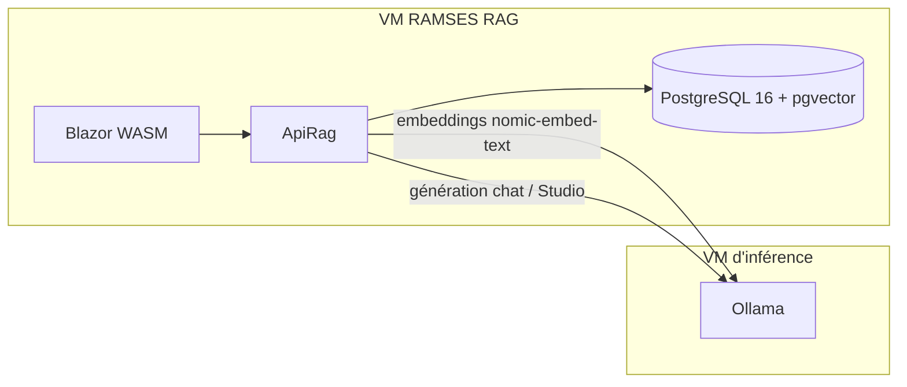

# Travail technique

## Statut : ✅ Confirmé pour la pile Enterprise livrée (prompts 2, 13, 15, 16)

Cette page décrit **comment RAMSES RAG traite un document**, de l'extraction jusqu'à la
réponse. L'installation physique (deux VM, ports, Compose) reste dans
[`architecture.md`](architecture.md). Ici : le pipeline applicatif, tel qu'il est
spécifié dans `docs/prompt-*` et `docs/entreprise/`.

Périmètre : **ApiRag** et **BlazorWasmRag.Enterprise**. L'offre grand public (ApiPublic)
est [RAMSES IA](../RamsesIa/overview.md), pas cette page.

## Architecture applicative

Deux machines, un seul index documentaire.



| Couche | Rôle |
|---|---|
| Interface | Blazor WebAssembly. Chat, Calebasse, Bibliothèque, Paramètres, Support. |
| API | ApiRag (.NET). Auth, RLS, import, RAG, notebooks, Studio, exports. |
| Données | Une base Postgres : comptes, documents, chunks vectorisés, vases, artefacts. |
| Inférence | Ollama hors de la VM RAG (`INFERENCE_PROFILE=external`). Génération et embeddings. |

Le navigateur n'atteint que l'entrée HTTPS. Postgres et l'API restent sur le réseau interne.
Les poids des modèles ne sont pas sur la VM RAG.

Chaîne d'ingestion (prompts 13 et 21, puis 2) :

```text
Fichier → lecteur (signature réelle, pas seulement l'extension)
       → texte extrait
       → stratégie de chunking du tenant
       → embedding (nomic-embed-text, 768 dimensions)
       → INSERT document_chunks (pgvector, index HNSW cosine)
```

Chaîne de question dans un vase (prompts 9 et 14) :

```text
Question → embedding de la requête
        → k plus proches chunks, filtrés par la RLS du moment
        → et restreints aux sources du vase
        → prompt serveur + extraits
        → réponse streamée + citations
```

Le chat **direct** (sans vase) n'interroge pas cet index. Le modèle voit le message, une
image éventuelle, et le texte des pièces jointes de la discussion (prompt 18). Rien n'est
indexé.

## Chunking

Un **chunk** est un passage assez court pour être vectorisé, assez complet pour répondre.
Si le bon passage ne remonte pas, aucun modèle ne sauvera la recherche. On juge le
chunking aux **citations** de `/rag/query`, pas à l'œil.

Réglage : **compte Support** uniquement (page `/plateforme`), jamais l'Admin du client
(prompt 2). Défaut d'un tenant neuf : `Recursive`, taille 350, chevauchement 50.
Changer la stratégie **ne réécrit pas** l'index existant : il faut réindexer.

Quatre stratégies (`IChunkingStrategy`) :

| Stratégie | Unité | Comportement | Quand |
|---|---|---|---|
| **Recursive** (défaut) | Mots | Regroupe des phrases jusqu'à la taille cible, avec chevauchement. Migration de l'ancien `TextChunker`. | Texte courant, rapports, courriels exportés. |
| **FixedSize** | Caractères | Coupe à `ChunkSize`, recule au dernier espace, chevauche de `ChunkOverlap`. | Texte uniforme, peu de paragraphes. |
| **MarkdownAware** | Caractères | Coupe aux titres `#` / `##`. Ne coupe jamais un bloc de code ni un item de liste. Si une section est trop longue, redescend à une coupe par taille. **Aucun appel d'embedding.** | Manuels et specs déjà en Markdown, ou Word dont les titres ont été convertis en titres Markdown. |
| **Semantic** | Phrases | Embedding de chaque phrase, regroupement tant que la similarité cosinus reste au-dessus du seuil (défaut 0.75). | À n'activer qu'après mesure : **un embedding par phrase à l'indexation**. |

Ce que le chunking actuel ne fait pas encore (R&D, `docs/entreprise/RD_CHUNKING.MD`) :

- comptage en **tokens** du modèle (aujourd'hui mots ou caractères, selon la stratégie) ;
- titres de section recopiés dans le texte vectorisé ;
- recherche parent / enfant (petit chunk pour trouver, grand contexte pour répondre) ;
- **reranking** (voir plus bas).

Procédure terrain : `docs/entreprise/CHUNKING-CHECK.MD` — une variable à la fois, même
corpus, mêmes questions.

## Embeddings

Le modèle d'embedding est **`nomic-embed-text`**, 768 dimensions, servi par Ollama.

Chaque chunk devient un vecteur. La question aussi. On compare par **similarité cosinus**.
Plus le score est proche de 1, plus les deux textes « pointent » dans la même direction
sémantique.

Conséquences opérationnelles :

- La colonne SQL est `vector(768)`. Changer de modèle **ou** de dimension après le premier
  index est verrouillé : les anciens vecteurs ne seraient plus comparables.
- Un moteur d'embeddings injoignable à l'import renvoie **503** lisible, pas un 500.
- Seul le **texte libre** est vectorisé. Données chiffrées, colonnes structurées, formules
  Excel : hors index (prompt 19 / SqlAgent, non livré).

Seuil de similarité côté vase : environ **0.55** (point de départ pour ce modèle, pas une
mesure marketing).

## PostgreSQL + pgvector

Comptes, documents et vecteurs vivent dans **la même base**. Pas d'index vectoriel externe.

| Objet | Rôle |
|---|---|
| `documents` | Métadonnées, texte source, visibilité (`owner_user_id`, `department_id`, tenant). |
| `document_chunks` | Un chunk, son embedding, lien vers le document. |
| Index HNSW | `vector_cosine_ops` sur `embedding`. |
| RLS | Chaque `SELECT` est filtré par `app.user_id` / `app.role` / départements. |

Le rôle applicatif (`nanoia_app`) n'est pas le propriétaire de la base. Le DDL passe par un
compte d'administration. L'API refuse de démarrer si elle se connecte en superuser.

Un vase (`notebooks` / `notebook_sources`) **ne copie pas** les chunks. Il pointe des
`document_id`. À chaque question, la RLS est relue. Retirer un droit (sortie de département)
fait disparaître le document des réponses **même s'il reste listé** comme source.

## Reranking

**Non livré.** Après la recherche vectorielle, RAMSES n'applique pas de second modèle qui
reclasserait les extraits (cross-encoder, hybrid BM25 + vecteur, etc.).

Aujourd'hui : les *k* plus proches voisins cosinus, éventuellement coupés par un seuil, puis
le prompt. Un re-classement était prévu en phase 4bis, hors des prompts exécutés.

Conséquence QA : si la citation est mauvaise, on change d'abord le **chunking** et
l'échantillon, on n'attend pas un reranker.

## Décodage contraint (constrained decoding)

Livré côté Enterprise (prompt 15, `docs/entreprise/CONSTRAINT-DECODING.MD`).

Le modèle, laissé libre, invente du JSON, oublie un champ, ou glisse `[FOLLOW_UPS]` dans la
prose. Le **décodage contraint** masque, à chaque jeton, ceux qui casseraient un schéma JSON.
Ollama le fait nativement (`format` + schéma). Pas de vLLM, pas d'Outlines.

| ✅ Garantit | ❌ Ne garantit pas |
|---|---|
| JSON valide, champs présents, bons types | Que le contenu soit vrai |
| Valeurs dans une liste fermée (`enum`) | Qu'une citation soutienne réellement la phrase |
| Tailles de listes | La qualité de rédaction |

Règle retenue : **contraindre les petites pièces** (artefacts Studio, questions de suivi,
identifiants de sources), **streamer la prose**.

Dans le code livré :

| Surface | Comportement |
|---|---|
| Studio (rapport, carte, tableau) | `IStructuredAiService` + schéma. JSON invalide après retry → 502. |
| Questions de suivi | Événement SSE `followups`, plus de regex dans le navigateur. |
| Citations du vase | Événement SSE `cited` : marqueurs `[Source N]` hors bornes ignorés. |
| Prompt système | Possédé par le **serveur**. Un tour `system` envoyé par le client → 400. |

Le schéma garantit la forme. La validation serveur reste obligatoire après génération.

## Ce qui n'est pas dans cette pile

| Sujet | État |
|---|---|
| Reranking / hybrid search | Non livré |
| Cache sémantique des questions | V2, non implémenté |
| SqlAgent / vues client | Prompt 19, hors campagne actuelle |
| Claim licence `features` | Lu puis ignoré : Essentiel et Professionnel exposent les mêmes modules |
| Compétences, Programmé, plugins, agent | Prompts 26 à 30, hors recette tant que le journal n'est pas `TERMINE` |
| Localisation Enterprise FR/EN | Prompt 31, non finalisé |
